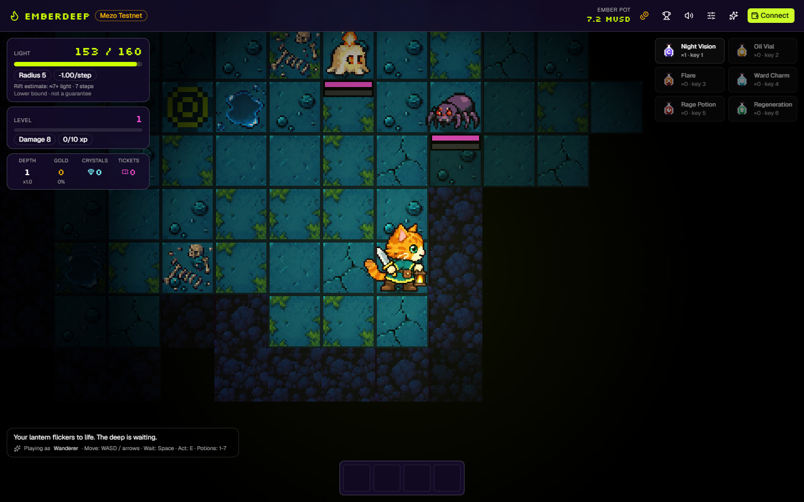
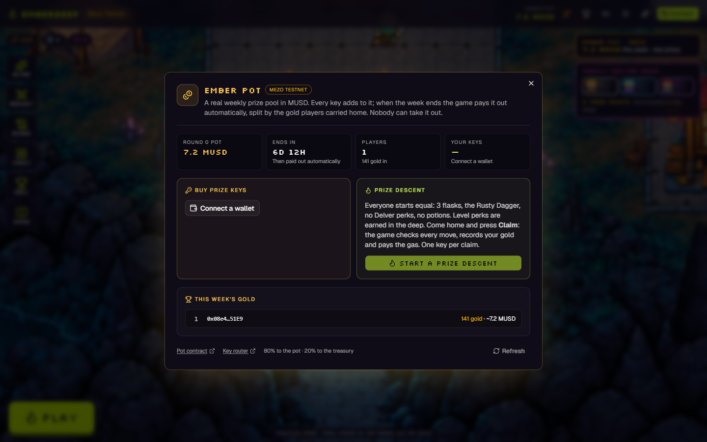
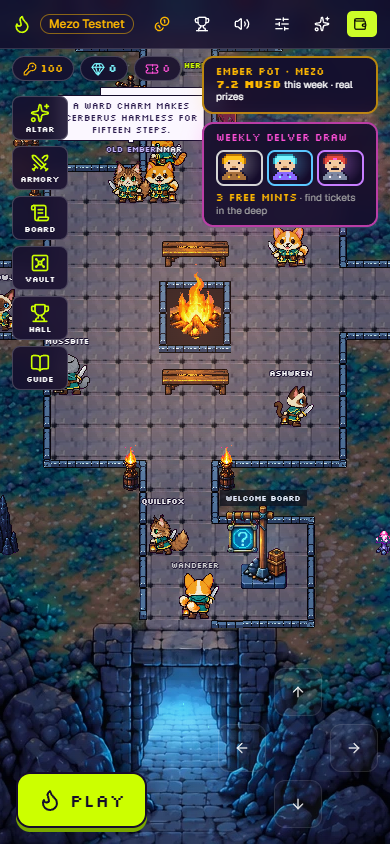
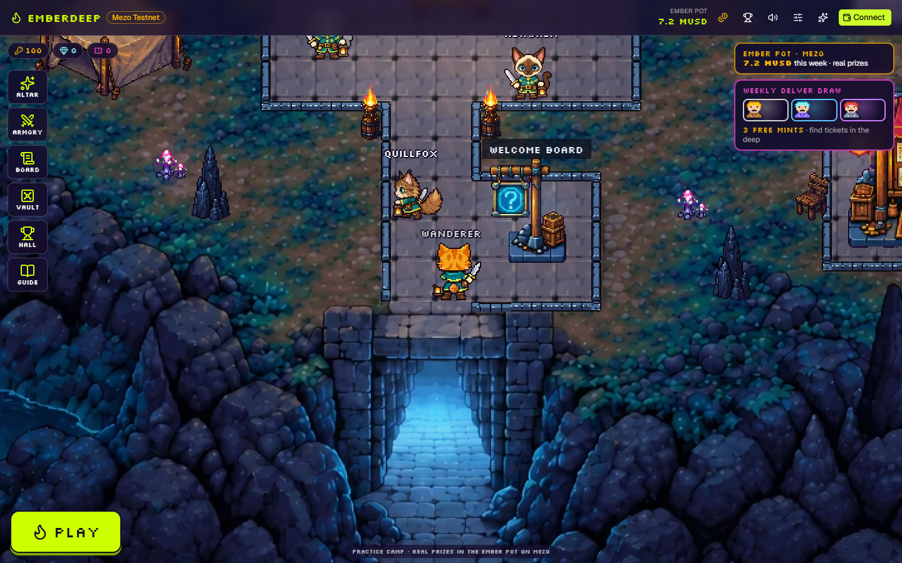

# Emberdeep on Mezo

A pixel roguelike where skill wins, with a **real weekly MUSD prize pool on [Mezo](https://mezo.org)**.
You descend with a lantern, light is your only resource, and you bring gold home through the rift. Prize descents
start with the same loadout for everyone, except a found weapon you hold; the gold you carry home takes its share of
the week's **Ember Pot**. Slay Cerberus on a prize descent and its chest holds a **weapon NFT** you can carry, or sell
at the **Market** for MUSD.

**Play:** https://108-61-197-158.sslip.io (Mezo Testnet) &nbsp;·&nbsp; **Mezo Buildathon, Wave 2**

<p align="center">
  
</p>
<p align="center">
  
  
</p>

## The loop on Mezo

```
buy a key (MUSD, or BTC / MEZO swapped on Tigris; or open a Mezo trove from the game: BTC in, MUSD out)
  → prize descent → Claim: the gold goes into this week's Ember Pot (1 key spent)
  → slew Cerberus? open its chest: a weapon NFT (EmberItems)
  → carry it into the next descent, or list it at the Market
  → a buyer pays MUSD, BTC or MEZO (swapped on Tigris) → 5% of the sale goes into the Ember Pot
  → the week ends: the pot is paid out by gold, automatically
```

## New in Wave 2

- **Found weapons as NFTs.** `EmberItems` (ERC-721): a pickaxe, axe, sword or spear, each Common to Legendary
  (70 / 22 / 6.5 / 1.5%), with eight finishes. They play differently: the pickaxe is weak but finds 15% more gold, the
  axe hits hard, the sword carries a level perk at its rarity's rank, and the rare spear hits hardest and restores light
  on every kill. Each rarity has its own drawn icon (Common, Rare, a Norse Epic and a Roman Legendary).
- **Cerberus chests, paid by a key.** A chest opens only for a prize descent that slew Cerberus, came home and is
  already claimed into the Ember Pot, so every chest costs a key and 80% of it is in the pot. The server rolls the
  chest from a secret (an HMAC of the pot record), signs it, and its relayer mints it, paying the gas. One chest per
  record: the same moves sent again roll nothing new unless they are claimed into the pot again, with another key.
  100% on testnet; 20% planned for mainnet. An unopened chest is kept in the browser and listed in the Armory until
  it is opened, and it stays yours to open even if you sell the weapon you carried.
- **Weapons in prize descents.** A found weapon replaces the equal loadout's dagger; the server checks on chain that
  the player holds that very item when it signs the claim. (It is checked at the claim, not at the start: see
  "How a record is checked".)
- **Item metadata.** `tokenURI` points at the game's server, `/api/item/<id>`, which reads the item from the chain
  and answers standard ERC-721 metadata: name, description, a 256px picture for its kind and rarity, and its kind,
  rarity, finish, damage and perks as attributes. So found weapons show up in wallets and on the Mezo explorer.
- **The Market.** `EmberMarket`: escrow listings priced in MUSD; buy with MUSD, or with BTC or MEZO swapped on Tigris in
  the same transaction (the buttons show the quote; leftover MUSD comes back). A seller can take an unsold item back
  at any time. 5% of every sale goes into the current week of the Ember Pot.
- **EmberPotV3.** The pot with `fund()`, through which the Market pays its fee, and `fundedIn`, which the pot window
  shows as "From Market sales". Everything else is unchanged from V2.
- **Borrow MUSD against BTC, from the game.** Short of MUSD for keys or a weapon? One button opens a trove on Mezo's
  own `BorrowerOperations` (`openTrove`, the BTC sent as collateral), or borrows more from the player's trove
  (`adjustTrove`, adding BTC when needed). The game reads Mezo's terms first (its price feed, its smallest loan of
  1,800 MUSD, its fee and gas compensation) and sizes the BTC for a safe 65% loan-to-value, which keeps the loan above
  the 150% collateral ratio Mezo needs in recovery mode; the list hints come from `SortedTroves.findInsertPosition`.
  The trove is the player's own, to repay or close in Mezo's app.
- **A one-page deploy** (`deploy-mezo.html`) for the four contracts and the market's collection, and a server setup
  that reuses saved keys, so the contracts keep trusting the same signer across servers.

## How it uses Mezo

- **MUSD prize pool.** A prize key costs 1 MUSD: 80% goes into this week's pot, 20% to the treasury. No game token,
  no inflation, and no function that lets anyone, us included, take the pot out.
- **Pay with BTC or MEZO.** `EmberKeyRouter` swaps BTC or MEZO to MUSD on **Tigris** and buys the keys in one
  transaction. It has no owner and no admin functions, and keeps nothing between calls; leftover MUSD goes back to
  the player.
- **Claim in one click.** After a prize descent the game's server replays every move and signs only the true result;
  its relayer sends it to the pot and to the **Hall of Descents** on Mezo and pays the gas. The player signs one
  login message a week (no transaction), so nobody can spend another player's keys.
- **Automatic weekly payout.** When the week ends the server calls `distribute`: everyone is paid by gold, straight
  to their wallet. Anyone else may call it too, so a server outage can never hold the pot back. A week without gold
  rolls its pot into the next one.

| On Mezo Testnet (chain 31611) | Address | Source |
| --- | --- | --- |
| Ember Pot (V3) | [`0x46cc1c7abe317aaa77ac6df3f206fa38c8b7b86c`](https://explorer.test.mezo.org/address/0x46cc1c7abe317aaa77ac6df3f206fa38c8b7b86c) | [`contracts/ember-pot/EmberPotV3.sol`](contracts/ember-pot/EmberPotV3.sol) |
| Key router (BTC or MEZO → keys) | [`0xe81eeb4ac622be0ffe6b127b4e86d93bbd560d3a`](https://explorer.test.mezo.org/address/0xe81eeb4ac622be0ffe6b127b4e86d93bbd560d3a) | [`contracts/EmberKeyRouter.sol`](contracts/EmberKeyRouter.sol) |
| EmberItems (weapon NFTs) | [`0xc36a4c19760dc368c719eba29159d639b2f62362`](https://explorer.test.mezo.org/address/0xc36a4c19760dc368c719eba29159d639b2f62362) | [`contracts/EmberItems.sol`](contracts/EmberItems.sol) |
| EmberMarket | [`0x4c598c2146a30b9595b3c224c47fae13ba7a4a04`](https://explorer.test.mezo.org/address/0x4c598c2146a30b9595b3c224c47fae13ba7a4a04) | [`contracts/EmberMarket.sol`](contracts/EmberMarket.sol) |
| Hall of Descents | [`0x0fa55bd6f5a0c7831bc2fadbae90cb62b347bdd6`](https://explorer.test.mezo.org/address/0x0fa55bd6f5a0c7831bc2fadbae90cb62b347bdd6) | [`contracts/EmberdeepHall.sol`](contracts/EmberdeepHall.sol) |
| MUSD · MEZO · BTC | `0x118917a40FAF1CD7a13dB0Ef56C86De7973Ac503` · `0x7b7c…0001` · `0x7b7c…0000` | Mezo |
| Mezo's lending (troves) | BorrowerOperations [`0xCdF7028ceAB81fA0C6971208e83fa7872994beE5`](https://explorer.test.mezo.org/address/0xCdF7028ceAB81fA0C6971208e83fa7872994beE5) | Mezo |
| Ember Pot V2 (Wave 1, retired) | [`0x7a3e5548a81456ae695d058a90aa73ca543b16eb`](https://explorer.test.mezo.org/address/0x7a3e5548a81456ae695d058a90aa73ca543b16eb) | its last week is still paid out by the server |

The Wave 2 contracts were deployed on 15 November 2026 from `deploy-mezo.html`, all owned by
`0x08e4f62eD093124AA3cE257830c81B2bC14A51E9`, with the game server's signer `0xc0702Ec1ee458D746aE4DDEd8316c3D397001240`.
Found weapons' metadata: `https://108-61-197-158.sslip.io/api/item/<id>`.

**What the owners can and cannot do.** Nobody can take MUSD out of the pot or a listed item out of the Market.
The pot's owner can change the key price and the signer and pause key sales. The Market's owner can only choose which
collections may be listed. The items' owner can change the signer, the metadata URI and who may mint, and pause
minting; the server's signing key opens chests, so a stolen key could mint items until the owner replaces it.
Those are testnet trade-offs; a daily mint cap comes before mainnet.

**What is real and what is not.** Real money lives only in the Ember Pot. The camp around it (shop, altar, draw)
runs on crystals you find in the deep and is kept in your browser.

## A prize descent, end to end

1. Open the **Ember Pot** (the gold coin in the header) and connect a wallet on Mezo Testnet.
2. Buy a key with **MUSD, BTC or MEZO**. 80% of it lands in this week's pot.
3. **Start a prize descent.** Everyone gets the same loadout: 3 lantern flasks, the Rusty Dagger, no Delver perks, no
   potions. The one thing that differs is a found weapon you hold, which replaces the dagger. Level perks are earned in
   the deep, the same for everyone.
4. Collect gold, survive, and walk back to the rift. Lose the light and the gold is lost with it.
5. The report shows everything you carried home and one button: **Claim N gold**. The server replays the descent,
   signs it and records it in the pot (it spends one key) and on the Hall of Descents. You pay no gas.
6. Slew Cerberus? Right under the claim, **Open the chest**: a weapon NFT is minted to your wallet, gas paid.
7. When the week ends, the pot is paid out by gold, automatically.

The server signs a pot record only for the prize loadout (with the dagger, or a found weapon the player holds), only
for a descent that came home, with gold capped at 5,000 a run, and with a deadline inside the current round.

## The game

<p align="center">
  
</p>

**The camp.** A painted underground camp fills the whole screen. Your character walks a fire-lit plaza with seven
buildings: press **E** next to one, tap it, or use the icon rail on the left.

| Building | What it does |
| --- | --- |
| **Dungeon Gate** (big **PLAY** button) | Pick who descends and light the lantern; practice keys and oil are free; the way into a prize descent |
| **Ember Altar** | Mint Delvers with crystals, send them on expeditions |
| **Armory** | Your found weapons and unopened chests; camp weapons, armor and potions, paid with crystals |
| **Draw Board** | The weekly draw for free Delver mints, your tickets and the passes |
| **Vault** | This week's Ember Pot, your keys and your camp |
| **Welcome Board** | How a descent works, step by step |
| **Hall of Delvers** | Your own records, and the Hall of Descents on Mezo |

Other delvers wander the camp with name tags and chatter. They are ambience, not other players.

**The descent.** Floors 1-7 have authored tile layouts: Catacombs (1-2), Mycelium (3-4), Cinderworks (5-6) and
Hollowglass (7), and all of them sit under fog of war. Floor 7, Cerberus's, is the bottom of the deep. Every step burns light. Vision
stays wide until the last 25 light, then narrows. Deeper floors pay more (+40% loot per depth) but burn more light.
Walk back to the rift you arrived through to extract; if your light and Night Vision run out, everything you carried
is lost.

**Creatures.** Nine kinds (Waxling, Cave Spider, Lantern Moth, Skeleton Archer, Wisp, Stone Golem, Skull Crab, Spore
Shroom, Imp), more of them the deeper you go. They never hit without warning: a creature that reaches you **winds
up**, and the tiles its blow will hit get a red ring for one or two turns. Step off the rings and the blow lands on
nothing, leaving the creature open. Stay and it drinks your light. Bump into a creature to attack it.

**Smash things.** Urns, crates, barrels and old sacks hide the floor's gold, crystals and oil: each gives one kind of
loot, sometimes two, plus experience, and now and then a piece of gear (Rusty Sword, Hand Axe, Miner's Pickaxe) for
the rest of the descent. The emptier your lantern, the likelier the loot is oil. A blow costs a turn but no light.

**Levels and perks.** Every descent starts at level 1. Each new level adds lantern capacity, light and damage, and
offers three seeded perks (choose with 1/2/3 or a tap): a run holds at most four different perks, each with three
ranks. Fifteen perks change the rules rather than add percentages: Oil Thief, Steady Wick, Wide Glass, Ember Heart,
Last Flicker, Riposte, Heavy Blow, Momentum, Thick Coat, Stone Ward, Interrupt (never on the boss), Deep Breath, Rift
Sense, Second Wind and the risky Hungry Flame. See [level perks](docs/design/level-perks-2026-10.md).

**Cerberus.** Depth 7 ends in an arena guarded by a three-headed hound (2x2 tiles, 150 HP). It marks the cells it
will hit, winds up, strikes for 40 light, then recovers for two turns: step off the marks and attack while it
recovers. It leaves a **Cerberus Hoard**: gold, crystals, a Healing Draught, a Rage Potion and a chance of a Soul
Sigil. Its floor is the last: once it falls, the only way on is back to the rift. You can also skip it and leave
through the rift.

**Sound.** The music, the four cave soundscapes and every creature's windup, strike and death are synthesized live:
no samples or downloaded music. The music muffles as your lantern dims, with a heartbeat at low light.
See [the sound lab](docs/audio/sound-lab.html).

## The camp economy (crystals)

Nothing in camp costs money. **Practice keys** are free (topped up to 100), and so is lantern oil for practice
descents. **Crystals** you bring home are the camp's currency:

| Item | Crystals |
| --- | --- |
| Rusty Dagger · Emberblade (swords are found in the deep now) | 6 · 100 |
| Leather Vest · Chain Mail · Emberplate | 18 · 52 · 122 |
| Potions (Night Vision, Oil Vial, Flare, Ward Charm, Rage, Regeneration) | 4 to 16 |
| Delver mint: Common · Rare · Epic · Legendary | 10 · 25 · 60 · 150 |
| Ember Pass · Deep Pass (better ticket drops for a week) | 50 · 100 |
| Expedition (plus an optional pack) | 10 (+3 to +9) |

**Delvers** are characters with a class perk (Prospector gold, Crystal Seer crystals, Lamplighter light, Pathfinder
cheaper steps, Duelist damage, Scavenger chests) and a fixed supply: 999 Common, 111 Rare, 69 Epic, 11 Legendary.
They also come free from a Soul Sigil (a Sealed Vault holds one 30% of the time) or from the **weekly draw**, which
mints three Delvers for draw tickets found in the deep. Delver perks apply to practice descents only; a prize descent
takes none of the camp's gear, only a found weapon.

## How a record is checked

The whole game is one pure function, `applyAction(state, action)` in `src/game/run.ts`: the dungeon, the creatures
and the loot all come from the seed. The game keeps every move. The signing server (`server/attest.ts`) replays the
descent from its setup and moves; only if the replay ends exactly as claimed does it sign the result (EIP-712). The
contracts take no record without that signature, credit it only to the player it was signed for, and only once.
A chest is checked the same way, and only against a record the pot already holds.

**Server-issued starts.** A prize descent is started by the server, not the browser: `/api/start` picks the seed and
signs it together with the player and the weapon they carry, and the Ember Pot takes no descent without that signed
start. A player gets a new seed only every two hours or after a claim, and one start counts for one claim, so nobody
can look through maps for an easy one (the dungeon is public code) or learn one map by playing it over. The weapon is
fixed before the first move.

What it proves: the gold and depth came from real play under the game's rules, on a map the server picked. What it
does not prove: the server is trusted to pick seeds at random and to replay honestly; its books of starts live in
memory, so a restart simply hands out new seeds.

## Run locally

Requires Node.js 22+.

```sh
npm install
npm run dev          # the full build at http://localhost:5741
npx vite --mode production --port 5743   # the Mezo build, as published (VITE_ARC=off in .env.production)
```

Other scripts:

```sh
npm test             # 623 tests: game rules, replay, balance sims, the contracts in an in-memory EVM, the server and relayer
npm run typecheck
npm run lint
npm run build        # static site in dist/ (the Mezo build)
npm run hall:compile # compile the Hall, key router, pot V3, items and market into contracts/out/
npm run server:build # build the signing server into server-dist/attest.mjs
```

The Ember Pot has its own Foundry tests: see [contracts/ember-pot](contracts/ember-pot/).

## Deploy

The site in `dist/` is static. `deploy/README.md` walks through a small Vultr server with free HTTPS:
`deploy/deploy.sh <IP>` uploads the site, `deploy/attest.sh <IP>` installs the signing server, its relayer key and the
automatic payout. The contracts are deployed from the owner's wallet with the dev pages: `deploy-mezo.html` (Wave 2:
the pot V3, its key router, the items and the market) and `deploy-hall.html` (the Hall). Order of steps:
[deploy/README.md](deploy/README.md#wave-2-on-mezo-the-new-pot-items-and-market).

## Controls

- **Camp:** WASD or arrows to walk, E / Enter / Space to open the building you face, or tap a building.
- **Descent:** WASD or arrows to move, Space to wait, E or Enter to take the stairs or extract, 1–7 for potions,
  1/2/3 to choose a perk.
- **Touch:** on-screen D-pad, or tap beside your character.
- Mute, music and effects volume, and reduced motion are in the header.

## Stack

Vite, React 19, TypeScript, Tailwind CSS v4, shadcn/ui (Base UI), zustand, viem and Vitest; Canvas 2D for the game.
Contracts in Solidity 0.8.28: the Hall, key router, items and market on Solady, the Ember Pot on OpenZeppelin; all
of them tested in an in-memory EVM (ethereumjs), the pot also with Foundry. The signing server and relayer are plain
Node.

## Next

- Delvers as NFTs too, listed on the same Market.
- Mezo mainnet, after the testnet weeks run cleanly: a 20% chest chance and a daily mint cap.

## Credits

Built with AI assistance (Claude). Fonts Geist and Silkscreen (SIL OFL) via Fontsource. See [NOTICE.md](NOTICE.md).

## License

MIT, see [LICENSE](LICENSE).
