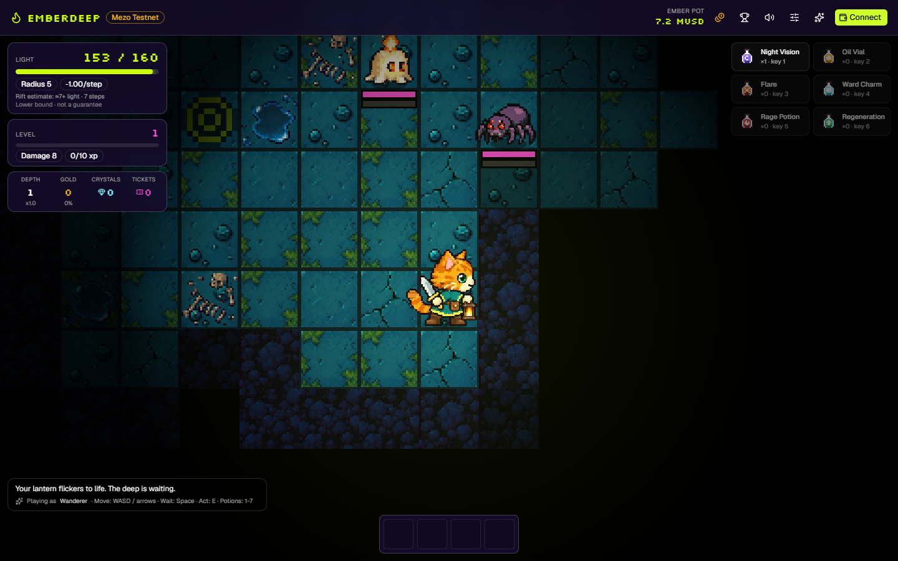
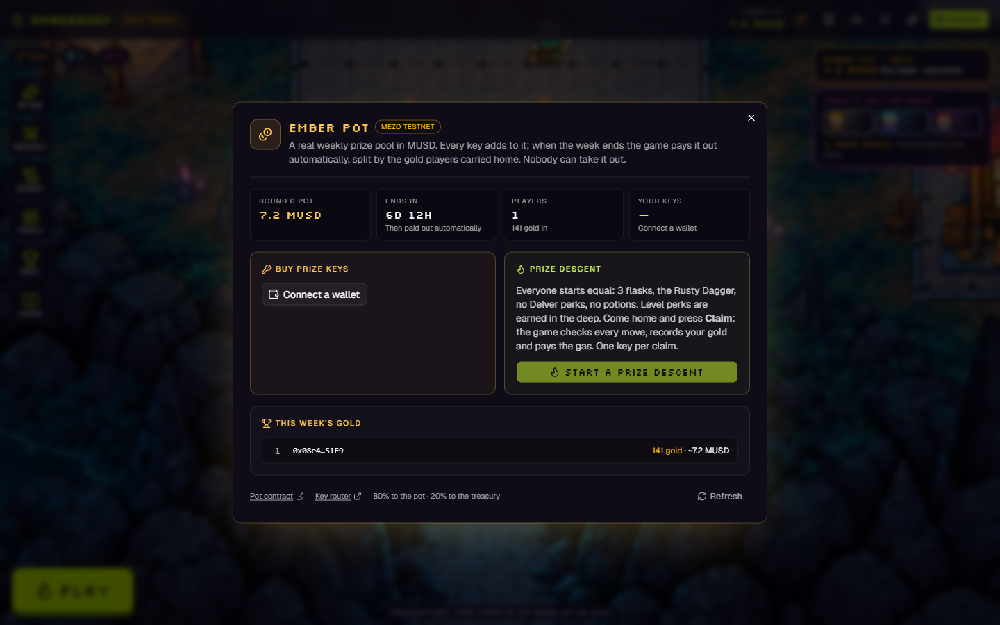
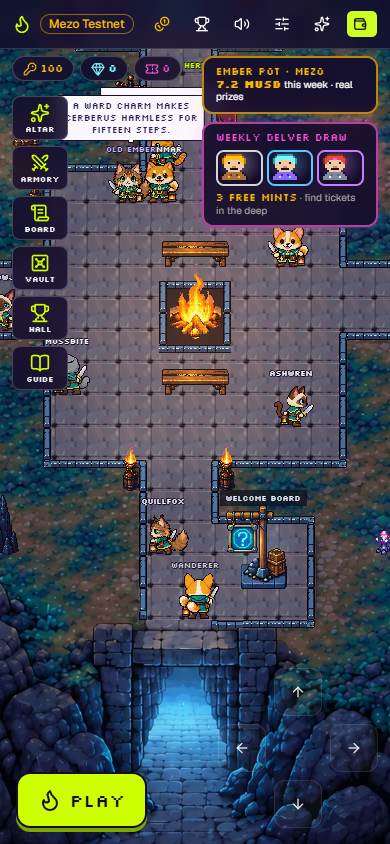
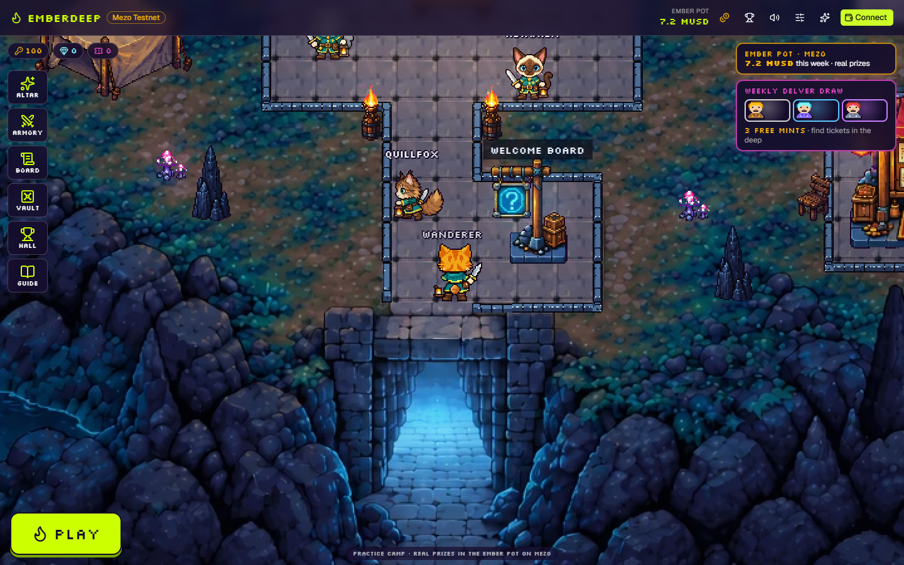

# Emberdeep on Mezo

A pixel roguelike where skill wins, with a **real weekly MUSD prize pool on [Mezo](https://mezo.org)**.
You descend with a lantern, light is your only resource, and you bring gold home through the rift. Prize descents
start equal for everyone; the gold you carry home takes its share of the week's **Ember Pot**.

**Play:** https://45-63-99-54.sslip.io (Mezo Testnet) &nbsp;·&nbsp; **Mezo Buildathon, Wave 1**

<p align="center">
  
</p>
<p align="center">
  
  
</p>

## How it uses Mezo

- **MUSD prize pool.** A prize key costs 1 MUSD: 80% goes into this week's pot, 20% to the treasury. No game token,
  no inflation, and no function that lets anyone, us included, take the pot out.
- **Pay with BTC or MEZO.** `EmberKeyRouter` swaps BTC or MEZO to MUSD on **Tigris** and buys the keys in one
  transaction. It has no owner and no admin functions, and keeps nothing between calls; leftover MUSD goes back to
  the player.
- **Claim in one click.** After a prize descent the game's server replays every move and signs only the true result;
  its relayer sends it to the pot and to the **Hall of Descents** on Mezo and pays the gas. The player signs one
  login message a week (no transaction), so nobody can spend another player's keys.
- **Automatic weekly payout.** When the week ends the server calls `distribute`: everyone is paid by gold, straight
  to their wallet. Anyone else may call it too, so a server outage can never hold the pot back. A week without gold
  rolls its pot into the next one.

| On Mezo Testnet (chain 31611) | Address | Source |
| --- | --- | --- |
| Ember Pot | [`0x7a3e5548a81456ae695d058a90aa73ca543b16eb`](https://explorer.test.mezo.org/address/0x7a3e5548a81456ae695d058a90aa73ca543b16eb) | [`contracts/ember-pot/`](contracts/ember-pot/) |
| Key router (BTC or MEZO → keys) | [`0x515e4e47a8bcd7e1b4ab4fc28b3d16b29dd58a9d`](https://explorer.test.mezo.org/address/0x515e4e47a8bcd7e1b4ab4fc28b3d16b29dd58a9d) | [`contracts/EmberKeyRouter.sol`](contracts/EmberKeyRouter.sol) |
| Hall of Descents | [`0x0fa55bd6f5a0c7831bc2fadbae90cb62b347bdd6`](https://explorer.test.mezo.org/address/0x0fa55bd6f5a0c7831bc2fadbae90cb62b347bdd6) | [`contracts/EmberdeepHall.sol`](contracts/EmberdeepHall.sol) |
| MUSD · MEZO · BTC | `0x118917a40FAF1CD7a13dB0Ef56C86De7973Ac503` · `0x7b7c…0001` · `0x7b7c…0000` | Mezo |

**What is real and what is not.** Real money lives only in the Ember Pot. The camp around it (shop, altar, draw)
runs on crystals you find in the deep and is kept in your browser.

## A prize descent, end to end

1. Open the **Ember Pot** (the gold coin in the header) and connect a wallet on Mezo Testnet.
2. Buy a key with **MUSD, BTC or MEZO**. 80% of it lands in this week's pot.
3. **Start a prize descent.** Everyone gets the same loadout: 3 lantern flasks, the Rusty Dagger, no Delver perks,
   no potions. Level perks are earned in the deep, the same for everyone.
4. Collect gold, survive, and walk back to the rift. Lose the light and the gold is lost with it.
5. The report shows everything you carried home and one button: **Claim N gold**. The server replays the descent,
   signs it and records it in the pot (it spends one key) and on the Hall of Descents. You pay no gas.
6. When the week ends, the pot is paid out by gold, automatically.

The server signs a pot record only for the prize loadout, only for a descent that came home, with gold capped at
5,000 a run, and with a deadline inside the current round.

## The game

<p align="center">
  
</p>

**The camp.** A painted underground camp fills the whole screen. Your character walks a fire-lit plaza with seven
buildings: press **E** next to one, tap it, or use the icon rail on the left.

| Building | What it does |
| --- | --- |
| **Dungeon Gate** (big **PLAY** button) | Pick who descends and light the lantern; practice keys and oil are free; the way into a prize descent |
| **Ember Altar** | Mint Delvers with crystals, send them on expeditions |
| **Armory** | Weapons, armor and potions, paid with crystals |
| **Draw Board** | The weekly draw for free Delver mints, your tickets and the passes |
| **Vault** | This week's Ember Pot, your keys and your camp |
| **Welcome Board** | How a descent works, step by step |
| **Hall of Delvers** | Your own records, and the Hall of Descents on Mezo |

Other delvers wander the camp with name tags and chatter. They are ambience, not other players.

**The descent.** Floors 1-7 have authored tile layouts: Catacombs (1-2), Mycelium (3-4), Cinderworks (5-6) and
Hollowglass (7); deeper floors are generated, and all of them sit under fog of war. Every step burns light. Vision
stays wide until the last 25 light, then narrows. Deeper floors pay more (+40% loot per depth) but burn more light.
Walk back to the rift you arrived through to extract; if your light and Night Vision run out, everything you carried
is lost.

**Creatures.** Nine kinds (Waxling, Cave Spider, Lantern Moth, Skeleton Archer, Wisp, Stone Golem, Skull Crab, Spore
Shroom, Imp), more of them the deeper you go. They never hit without warning: a creature that reaches you **winds
up**, and the tiles its blow will hit get a red ring for one or two turns. Step off the rings and the blow lands on
nothing, leaving the creature open. Stay and it drinks your light. Bump into a creature to attack it.

**Smash things.** Urns, crates, barrels and old sacks hide the floor's gold, crystals and oil: each gives one kind of
loot, sometimes two, plus experience, and now and then a piece of gear (Rusty Sword, Hand Axe, Miner's Pickaxe) for
the rest of the descent. The emptier your lantern, the likelier the loot is oil. A blow costs a turn but no light.

**Levels and perks.** Every descent starts at level 1. Each new level adds lantern capacity, light and damage, and
offers three seeded perks (choose with 1/2/3 or a tap): a run holds at most four different perks, each with three
ranks. Fifteen perks change the rules rather than add percentages: Oil Thief, Steady Wick, Wide Glass, Ember Heart,
Last Flicker, Riposte, Heavy Blow, Momentum, Thick Coat, Stone Ward, Interrupt (never on the boss), Deep Breath, Rift
Sense, Second Wind and the risky Hungry Flame. See [level perks](docs/design/level-perks-2026-10.md).

**Cerberus.** Depth 7 ends in an arena guarded by a three-headed hound (2x2 tiles, 150 HP). It marks the cells it
will hit, winds up, strikes for 40 light, then recovers for two turns: step off the marks and attack while it
recovers. It leaves a **Cerberus Hoard**: gold, crystals, a Healing Draught, a Rage Potion and a chance of a Soul
Sigil. You can also skip it and leave through the rift.

**Sound.** The music, the four cave soundscapes and every creature's windup, strike and death are synthesized live:
no samples or downloaded music. The music muffles as your lantern dims, with a heartbeat at low light.
See [the sound lab](docs/audio/sound-lab.html).

## The camp economy (crystals)

Nothing in camp costs money. **Practice keys** are free (topped up to 100), and so is lantern oil for practice
descents. **Crystals** you bring home are the camp's currency:

| Item | Crystals |
| --- | --- |
| Rusty Dagger · Iron Sword · Emberblade | 6 · 35 · 100 |
| Leather Vest · Chain Mail · Emberplate | 18 · 52 · 122 |
| Potions (Night Vision, Oil Vial, Flare, Ward Charm, Rage, Regeneration) | 4 to 16 |
| Delver mint: Common · Rare · Epic · Legendary | 10 · 25 · 60 · 150 |
| Ember Pass · Deep Pass (better ticket drops for a week) | 50 · 100 |
| Expedition (plus an optional pack) | 10 (+3 to +9) |

**Delvers** are characters with a class perk (Prospector gold, Crystal Seer crystals, Lamplighter light, Pathfinder
cheaper steps, Duelist damage, Scavenger chests) and a fixed supply: 999 Common, 111 Rare, 69 Epic, 11 Legendary.
They also come free from a Soul Sigil (a Sealed Vault holds one 30% of the time) or from the **weekly draw**, which
mints three Delvers for draw tickets found in the deep. Delver perks apply to practice descents only; prize descents
start equal.

## How a record is checked

The whole game is one pure function, `applyAction(state, action)` in `src/game/run.ts`: the dungeon, the creatures
and the loot all come from the seed. The game keeps every move. The signing server (`server/attest.ts`) replays the
descent from its setup and moves; only if the replay ends exactly as claimed does it sign the result (EIP-712). The
contracts take no record without that signature, credit it only to the player it was signed for, and only once.

What it proves: the gold and depth came from real play under the game's rules. What it does not yet prove: the seed
is chosen by the browser, so a player could look for a good map before playing (a server-issued seed is the next
step).

## Run locally

Requires Node.js 22+.

```sh
npm install
npm run dev          # the full build at http://localhost:5741
npx vite --mode production --port 5743   # the Mezo build, as published (VITE_ARC=off in .env.production)
```

Other scripts:

```sh
npm test             # game rules, replay, balance sims, the contracts in an in-memory EVM, the signing server and relayer
npm run typecheck
npm run lint
npm run build        # static site in dist/ (the Mezo build)
npm run hall:compile # compile the Hall and the key router into contracts/out/
npm run server:build # build the signing server into server-dist/attest.mjs
```

The Ember Pot has its own Foundry tests: see [contracts/ember-pot](contracts/ember-pot/).

## Deploy

The site in `dist/` is static. `deploy/README.md` walks through a small Vultr server with free HTTPS:
`deploy/deploy.sh <IP>` uploads the site, `deploy/attest.sh <IP>` installs the signing server, its relayer key and the
automatic payout. The contracts are deployed from the owner's wallet with the dev page `deploy-hall.html`
(Mezo Testnet: the pot, the key router and the Hall).

## Controls

- **Camp:** WASD or arrows to walk, E / Enter / Space to open the building you face, or tap a building.
- **Descent:** WASD or arrows to move, Space to wait, E or Enter to take the stairs or extract, 1–7 for potions,
  1/2/3 to choose a perk.
- **Touch:** on-screen D-pad, or tap beside your character.
- Mute, music and effects volume, and reduced motion are in the header.

## Stack

Vite, React 19, TypeScript, Tailwind CSS v4, shadcn/ui (Base UI), zustand, viem and Vitest; Canvas 2D for the game.
Contracts: the Hall and the key router in Solidity 0.8.28 on Solady, tested in an in-memory EVM (ethereumjs); the
Ember Pot on OpenZeppelin, tested with Foundry. The signing server and relayer are plain Node.

## Next

- Delver NFTs on Mezo and a marketplace priced in MUSD, with a share of every sale into the weekly pot.
- Server-issued seeds for prize descents.
- Mezo mainnet, after the testnet weeks run cleanly.

## Credits

Built with AI assistance (Claude). Fonts Geist and Silkscreen (SIL OFL) via Fontsource. See [NOTICE.md](NOTICE.md).

## License

MIT, see [LICENSE](LICENSE).
