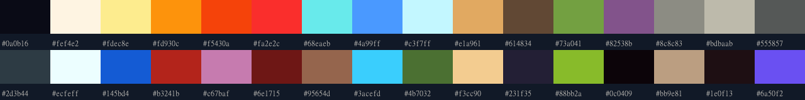

# Mob appearance review — 2026-10-25

Nine ordinary mobs now share a frozen 32-colour palette and a consistent dark outer rim. Raw artwork, dimensions, feet, species IDs and gameplay are unchanged. The dev gallery uses production drawing/animation and an unchanged cat hero for scale. Before/after tours show every mob on every theme, both facings and both lighting modes. This improves consistency; it does not invent missing anatomy, poses or viewing angles.

## Stage 1: gallery and untouched baseline

Open `http://127.0.0.1:5741/mob-gallery.html` after `npm run dev`. This HTML entry is absent from `dist/`.

- Four static source frames (`a/b/w/s`), right and mirrored left, zoom 2, smoothing disabled.
- The real `CreatureAnimator` runs idle, movement, windup, strike and recovery. `drawCreature` is the dungeon's existing function; only its export changed.
- Production tile helpers provide all four floors, without optional decorations. Every live preview includes the unchanged Scottish Fold hero for scale.
- Plain and lantern modes. The existing overlay was extracted into `src/render/lantern-light.ts`, retaining its gradient stops, tint, radius and flicker formulas. Both game and gallery use it. The gallery does not simulate discovery/fog or a real descent.
- The 18-second tour scrolls through four theme pages, each showing all nine mobs, both directions, plain light above and lantern light below. Pause, selectors and return from tour are available.
- Isolated presentation fixtures only: no wallet, saves, RNG, `applyAction`, combat delay or economy call.

The initial baseline was captured **before any mob PNG changed**. Original strips and large captures are local-only. A fresh checkout restores the old strips directly from `13183e7` with the command below; repeated `before` runs serve them through Playwright routing without replacing live PNGs. Both tours use the same gallery version.

```powershell
node scripts/mob-gallery-smoke.mjs before http://127.0.0.1:5741/ 13183e7
node scripts/mob-gallery-smoke.mjs after http://127.0.0.1:5741/
node scripts/mob-video-qa.mjs http://127.0.0.1:5741/
```

Channel: `SMOKE_CHANNEL`, default `msedge`. No browser binaries/packages were downloaded.

## Stage 2: mob-only processing

`node scripts/sprite-sheets.mjs mobs` imports the same nine raw WebPs. Only its `public/mobs/` branch uses the new processing. Heroes, boss, props, lobby and tiles retain their existing processing.



`art/palette/mobs.json` contains 32 colours, sampled from the nine baseline mob strips and four existing tile atlases (relative weights 1 and 0.15). Eighteen nearest-source accents/neutral shades were locked before fourteen weighted OKLab clusters were fitted. They include warm eyes/fire, spider red, golem cyan, moth wings, violet, neutral stone, bone/wax and a distinct cold white for Wisp. Normal regeneration never refits this frozen palette.

Every opaque pixel belongs to the palette. Selection uses linear-sRGB-to-OKLab conversion and squared perceptual distance, without dithering. Output is still **768x112**, four **192x112** texture cells corresponding to **96x56** logical cells; original heights and foot anchors are unchanged.

- Each image gets a separate block-size estimate from horizontal/vertical colour-edge periodicity across body frames. The search varies size and phase; equal-strength harmonics prefer the full block period. Weak evidence falls back to the height-derived estimate.
- The measured period controls sampling width and sub-grid alignment. The output lattice is one texture pixel (half a logical pixel), consistent with the existing 2x format. Alignment corrections are bounded to avoid moving an eye by a whole source block.
- A trial that collapsed everything to one **logical** pixel was rejected because it visibly damaged eyes/anatomy. It is not shipped. The detected size is an estimate; AI artwork need not contain a perfect grid.
- Magenta-contaminated edge samples borrow a safe foreground neighbour, or become transparent. Alpha is binary. The bowstring and web no longer retain pink matte.
- Solid silhouettes get one inward texture-pixel rim in **`#0a0b16`**. Thin web/arrow details and luminous Wisp/flame edges are protected from indiscriminate blackening. Internal dark shading is retained; not every internal stroke is redrawn.

## Per-mob review

All four before/after frames were inspected enlarged. No final mob needed a full legacy exception; raw WebPs remain untouched. The rejected coarse-grid experiment is separate from the accepted result. Counts exclude transparency and cover the entire four-frame strip.

| Mob | Source block estimate | Colours before → after | Accepted result / comparison |
| --- | --- | --- | --- |
| Waxling (`wickgnaw`) | 17.82 px | 255 → 21 | Warm eyes/flame retained; [four frames](../screenshots/mobs-compare-wickgnaw.png). |
| Cave Spider (`snaretoad`) | 16.70 px | 252 → 23 | Red eyes; light web without pink rim; [four frames](../screenshots/mobs-compare-snaretoad.png). |
| Lantern Moth (`cinder-hound`) | 12.45 px | 254 → 19 | Wing eye-spots/face/warm wing range retained; [four frames](../screenshots/mobs-compare-cinder-hound.png). |
| Skeleton Archer (`chaincoil`) | 16.61 px | 254 → 21 | Warm eye accents in every pose; clean bowstring; [four frames](../screenshots/mobs-compare-chaincoil.png). |
| Wisp (`needle-wraith`) | 19.21 px | 254 → 8 | Cold white/cyan flame, blue face; luminous edge intentionally not black; [four frames](../screenshots/mobs-compare-needle-wraith.png). |
| Stone Golem (`sootplate`) | 12.49 px | 251 → 23 | Cyan eyes, moss, shared neutral stone; [four frames](../screenshots/mobs-compare-sootplate.png). |
| Skull Crab (`hollow-burrower`) | 12.23 px | 254 → 20 | Bone shell, eye stalks/red claws retained; [four frames](../screenshots/mobs-compare-hollow-burrower.png). |
| Spore Shroom (`fourfold-bell`) | 20.20 px | 253 → 20 | Face, cap/pale spores retained; [four frames](../screenshots/mobs-compare-fourfold-bell.png). |
| Imp (`rift-leaper`) | 16.48 px | 252 → 20 | Yellow eyes, horns/red body retained; [four frames](../screenshots/mobs-compare-rift-leaper.png). |

To reproduce measurements and input/output SHA-256 fingerprints after restoring the baseline, run `node scripts/mob-look-report.mjs`; it writes the local `artifacts/mobs/look-metrics.json`. Under its explicit matte-colour predicate, Skeleton Archer went from **171** flagged opaque pixels to **0**; every final strip has **0**. This detects matte-like colour, not artistic perfection.

## Reproduce local evidence

Only the small `mobs-compare-*.png` comparisons and `mobs-palette.png` above are tracked screenshot evidence. All videos, full galleries, backups and machine reports are ignored local output. Run `npm run dev` in one terminal, then in another PowerShell terminal:

```powershell
$env:SMOKE_CHANNEL='msedge'
node scripts/mob-gallery-smoke.mjs before http://127.0.0.1:5741/ 13183e7
node scripts/mob-gallery-smoke.mjs after http://127.0.0.1:5741/
node scripts/mob-video-qa.mjs http://127.0.0.1:5741/
node scripts/mob-look-report.mjs
node scripts/lantern-light-smoke.mjs http://127.0.0.1:5741/
```

The first two commands recreate all four themes' plain/lantern screenshots as `docs/screenshots/mobs-{before,after}-<theme>[-lantern].png`, plus the current `mobs-<theme>.png` aliases. They also create `artifacts/mobs/gallery-{before,after}.webm` and their pose-coverage/console JSON reports. Each video is 1600x1024 with an 18-second tour plus short browser lead-in/out. Playback QA and decoded stills are local under `artifacts/mobs/`; exact duration is measured by the third command, not hardcoded as a permanent result.

## What needs new owner artwork

Cleanup cannot invent anatomy or hidden views, or turn painterly lighting into intentionally hand-authored pixel shading.

1. **Skeleton Archer — first redraw priority:** consistently constructed bow/string, crisp intentional bone shading and identical skull/eyes across poses. Current pink matte is fixed; improved source construction still needs artwork.
2. **Lantern Moth:** wing gradients/furry rendering remain softer than other designs. A redraw should retain warm eye-spots with deliberate shade clusters and shared pixel density.
3. **Stone Golem:** source micro-shading and stone-plane treatment remain different. A redraw can simplify planes while retaining cyan eyes/moss.
4. **All nine:** only right-facing `a/b/w/s` exist; left is mirrored, swapping asymmetric details. No genuine front/back views, hurt or death frames exist. White flash/knockback and existing effects do not create those poses. The other six do not need immediate regeneration for the accepted cleanup.

The separate **single-mob** prompt template **M4** is in [PROMPTS.md](../art/PROMPTS.md), ready first for Skeleton Archer, then Lantern Moth, Stone Golem, Waxling, Cave Spider, Wisp, Skull Crab, Spore Shroom and Imp. One image contains one monster: six poses by three directions. This future format is **not** supported by today's four-frame importer. No art was generated or extra states wired into the game; work on future source art stops at the prompt.

## Checks and scope

- `npm run typecheck`: pass.
- `npm run lint`: pass, only the three existing Fast Refresh warnings in button/badge/tabs.
- `npm test -- --maxWorkers=2`: **457/457**, 44 files. New tests cover reference OKLab conversion, independent synthetic grid sizes, fringe cleanup, exact visible/alpha atlas reproduction, palette membership/binary alpha/no matte, unchanged IDs/heights and paired eye accents in all four Archer/Spider/Golem faces.
- `npm run build`: pass; the dev gallery is absent from the site build.
- Edge gallery: all nine × four themes × two facings show `a/b/w/s`; both light modes; no console/page errors. Both WebMs decode, selected frames inspected. This is fixture QA, not a new full-descent/mobile playtest.
- Actual game RunView lantern check: floor 1, same generated seed 1383118661/cell (8,10)/157 light after three real keyboard moves, historical `13183e7` renderer vs extracted helper with identical accepted art and render clock: **0 changed canvas pixels**, no errors; recreate the local before/after screenshots with `node scripts/lantern-light-smoke.mjs http://127.0.0.1:5741/` (output `artifacts/mobs/lantern-light/`).
- `git diff --stat -- src/game` is empty. Scope also checked for server/contracts, heroes, tiles, lobby, boss, props and raw mob art. No IDs, prices, AI, turns, spawning, light costs, rules or replay changed. This commit itself needs no signing-server rebuild; previous pending rules still need their planned joint release.
- No dependencies installed, external binaries downloaded, keys accessed, push or deploy. Pre-existing unrelated HANDOFF/submission changes and two older untracked Catacombs sources are excluded from this commit.
